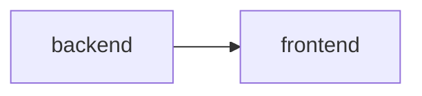

# Documentação

A documentação de um software é um conjunto de informações que descrevem o funcionamento, a utilização e a manutenção do
software. Ela é essencial para garantir que os usuários e desenvolvedores possam compreender e utilizar o software de
forma eficaz.

Quando falamos de documentação, falamos geralmente de dois tipos: em texto livre, que explica como o software funciona, 
ou uma documentação de API, que descreve as funções e métodos disponíveis para interação com o software. A documentação 
de API é especialmente importante para desenvolvedores que desejam integrar o software com outros sistemas ou criar 
extensões e plugins.

## Documentação em texto livre

A documentação em texto livre serve para instruir desenvolvedores que desejem retomar o projeto de software, ou então 
como um manual para usuários.

Este tipo de documentação **não necessariamente** precisa ser uma página Web. Ela também pode ser arquivos Markdown em
um projeto do tipo git.

Exemplos de documentação em texto livre:

* [Pacote coplin-db2](https://pypi.org/project/coplin-db2/)
* [Exemplo de documentação da disciplina](https://ctism-prof-henry.github.io/exemplo-projeto-software/docs/)

## Documentação de API

A documentação de API, diferentemente da documentação em texto livre, descreve funções, métodos, módulos, parâmetros, 
classes e outros componentes internos de um software. 

Uma API (Access Protocol Interface) é uma especificação de como um software deve acessar outro software. Portanto, essa
documentação é mais voltada para desenvolvedores de software, de maneira que eles saibam como acessar os recursos de outro
software.

Um exemplo disso é quando desenvolvedores de backend e frontend precisam desenvolver recursos de maneira paralela:



No frontend existe um botão que, por exemplo, pode criar um novo pedido para uma mesa em um restaurante. No backend
existe uma função que de fato cria este pedido, faz os lançamentos dos produtos, controle de estoque, etc. Portanto,
entre eles, existe uma API para comunicação. E a documentação da API descreve como esses dois softwares devem se 
comunicar.

**⚠️Atenção!⚠️** A documentação da API é comumente gerada de maneira automática a partir de comentários no código-fonte 
do software. Portanto, é importante que os desenvolvedores escrevam comentários para as funções:

```python
def criar_pedido(mesa: int, produtos: list) -> dict:
    """
    Cria um novo pedido para uma mesa específica.
    
    :param mesa: Número da mesa para a qual o pedido será criado.
    :param produtos: Lista de produtos a serem incluídos no pedido.
    :return: Detalhes do pedido criado, incluindo ID do pedido e status.
    """
    # Lógica para criar o pedido
    pass
```

Exemplo de documentação de API:

* [Pacote coplin-db2](https://coplin-ufsm.github.io/db2/)
* [Exemplo da biblioteca Swagger](https://petstore.swagger.io/)

## Tipos de documentos de um projeto de software

Abaixo são listados os tipos de documentos mais comuns de serem encontrados em projetos de software. 

### README.md

> [!NOTE]
> Muito comum, praticamente **TODO** projeto de software deve ter um!

É o arquivo de boas-vindas de um projeto de software. Quando colocamos um arquivo README.md em um projeto do GitHub, 
por exemplo, o texto em Markdown do documento é renderizado como HTML para a página do projeto. 

Nele descreve-se o propósito do software, como ele funciona, como instalá-lo e como utilizá-lo. Ele também pode conter 
informações sobre como contribuir para o projeto, como relatar problemas e como entrar em contato com os desenvolvedores.

Exemplo de README.md:

* [Exemplo de README.md da disciplina](https://github.com/CTISM-Prof-Henry/softwareEngineering/blob/main/README.md)

### AGENTS.md

> [!NOTE]
> Comum para projetos de software que utilizam agentes de IA.

Com o uso intensivo de agentes de IA a partir de 2024, tornou-se comum adicionar em projetos de software um documento do
tipo markdown, de nome `AGENTS.md`, que descreve instruções para agentes de IA de como eles devem se comportar ao 
manipular o código-fonte do projeto:

```markdown
# AGENTS.md

## Comandos de configuração
- Instalar dependências: `pnpm install`
- Iniciar servidor de desenvolvimento: `pnpm dev`
- Executar testes: `pnpm test`

## Estilo de código
- Modo estrito do TypeScript
- Use apóstrofes ('), não use ponto e vírgula (;)
- Use padrões funcionais quando possível
```

Adaptado de https://agents.md/

### CHANGELOG.md

> [!NOTE]
> Não tão comum, mas muito útil para projetos de software que evoluem rapidamente.

Registra as alterações realizadas entre versões do software.

É útil para que desenvolvedores e usuários saibam o que mudou, quais funcionalidades foram adicionadas e quais problemas
foram corrigidos.

Exemplo de CHANGELOG.md:

```markdown
# Changelog

## [1.2.0] - 2026-11-27
### Adicionado
- Cadastro de novos usuários.
- Exportação de relatórios em PDF.

### Corrigido
- Erro ao calcular o valor total dos pedidos.

## [1.1.0] - 2026-10-15
### Adicionado
- Controle de estoque.
```

### CONTRIBUTING.md

> [!NOTE]
> Não tão comum, mas muito útil para projetos que envolvem muitos desenvolvedores, especialmente projetos open source.

Descreve como outras pessoas podem contribuir com o projeto.

Pode conter instruções sobre:
- Como preparar o ambiente de desenvolvimento.
- Como executar os testes.
- Como criar branches.
- Como submeter alterações (Pull Requests).
- Convenções de código.

Exemplo: 

* [Projeto de backend de controle de gastos](https://github.com/COPLIN-UFSM/ngo-ccsh-backend/blob/main/DESENVOLVIMENTO.md)

### LICENSE

> [!NOTE]
> Comum em projetos do tipo open source, geralmente ausente em projetos individuais.

Define os termos legais de utilização, modificação e distribuição do software.

O GitHub gera automaticamente um arquivo LICENSE com base na licença escolhida pelo desenvolvedor do projeto, quando
criando um repositório novo.

Exemplo de licença (MIT License):

```text
MIT License
Licença MIT

Copyright (c) 2026 Detentor dos direitos

É concedida permissão, gratuitamente, a qualquer pessoa que obtenha uma cópia
deste software e dos arquivos de documentação associados (o "Software"), para
utilizar o Software sem restrições, incluindo, sem limitação, os direitos
de usar, copiar, modificar, mesclar, publicar, distribuir, sublicenciar e/ou vender
cópias do Software, e permitir que as pessoas a quem o Software é
fornecido o façam, sujeitas às seguintes condições:

O aviso de direitos autorais acima e este aviso de permissão devem ser incluídos em todas
as cópias ou partes substanciais do Software.

O SOFTWARE É FORNECIDO "NO ESTADO EM QUE SE ENCONTRA", SEM GARANTIA DE QUALQUER TIPO, EXPRESSA OU
IMPLÍCITA, INCLUINDO, MAS NÃO SE LIMITANDO A, GARANTIAS DE COMERCIALIZAÇÃO,
ADEQUAÇÃO A UM DETERMINADO FIM E NÃO VIOLAÇÃO. EM NENHUMA HIPÓTESE OS
AUTORES OU TITULARES DE DIREITOS AUTORAIS SERÃO RESPONSÁVEIS POR QUALQUER REIVINDICAÇÃO, DANOS OU OUTRA
RESPONSABILIDADE, SEJA EM UMA AÇÃO CONTRATUAL, DELITUAL OU DE OUTRA NATUREZA, DECORRENTE
DE, OU RELACIONADA AO SOFTWARE, AO SEU USO OU A OUTRAS TRANSAÇÕES COM O
SOFTWARE.
```

## Recursos externos

1. [Tutorial de documentação com MKDocs](https://github.com/CTISM-Prof-Henry/mkdocsTutorial)